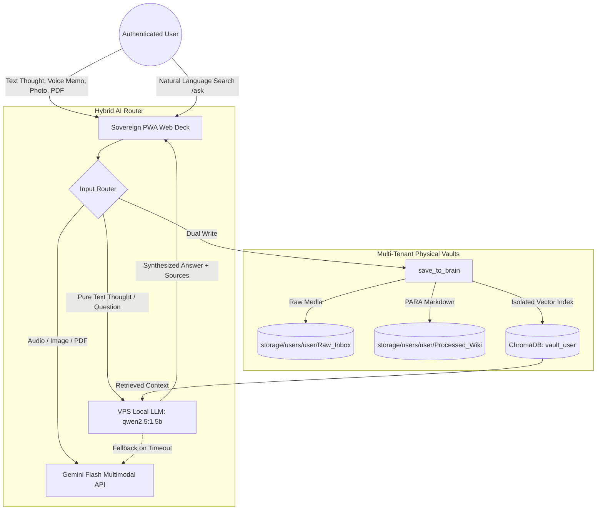

# Second Brain - Sovereign Multi-User Knowledge Engine

A self-hosted, multimodal personal knowledge and retrieval engine powered by a **Hybrid AI Router** (Local VPS LLM + Gemini Multimodal Cloud), strict multi-tenant vault isolation, and an installable Mobile PWA / Web deck.

---

## Architecture Overview



---

## Key Capabilities

### 1. Sovereign Web & Mobile PWA Interface
- **Zero Third-Party Intermediaries:** 100% self-hosted, independent frontend.
- **Native Browser Voice Memos:** Record audio thoughts directly from mobile or desktop browser microphone.
- **Drag & Drop Multimodal:** Snap phone photos, paste clipboard screenshots (`Ctrl+V`), or drop PDFs directly into the browser.
- **Conversational RAG (`/ask`):** Ask questions about past notes with instant source citations and temporal awareness (today's date calculations).
- **Mobile PWA Ready:** Installable on iOS (Safari Add to Home Screen) and Android (Chrome Install App) as a standalone app.

### 2. Hybrid AI Model Routing (Optimum Token & Speed Utilization)
- **Local VPS LLM (`qwen2.5:1.5b`):** Runs on your VPS via internal loopback (`127.0.0.1:11434`). Handles all pure text note classification, PARA slug generation, tagging, and queries in ~1 second with **0 cloud token cost**.
- **Gemini Multimodal Cloud:** Automatically invoked for heavy multimodal tasks: native voice transcription, document/PDF table extraction, and visual OCR.
- **Silent Fallback:** If the local model encounters high load or timeouts, it automatically falls back to Gemini Cloud so your note is never dropped.

### 3. Isolated Multi-User Vaults
- **Tenant Separation:** Each user has their own secure access token, separate physical disk directory (`storage/users/{username}/`), and separate ChromaDB collection.
- **Preconfigured Users:**
  - `shayeez` (10 GB storage quota)
  - `shamim` (10 GB storage quota)
  - `shayeez_shamim` (50 GB maximum storage quota)

---

## Batch Document & Media Ingestion CLI (`brain-import`)

Ingest entire folders of documents, PDFs, audio recordings, images, or Markdown notes in one command.

```bash
brain-import /path/to/my/folder [options]
```

### Storage Strategies (`--mode`):
1. **`copy` (Default):** Safely copies files into `Raw_Inbox/`, creates `.md` notes in `Processed_Wiki/`, and indexes vectors into ChromaDB. Protects against missing files if the original folder is moved or deleted.
2. **`move`:** Moves (cuts) files into `Raw_Inbox/`. Leaves **no duplicate files** on your computer.
3. **`reference`:** Leaves files in their original location on disk and records the path in Markdown frontmatter and ChromaDB metadata. Consumes **0 extra disk bytes**.

### Common CLI Examples:
```bash
# 1. Safe Dry-Run preview (checks files without modifying disk or spending tokens)
brain-import ~/Documents/Notes --dry-run

# 2. Ingest folder for user 'shayeez' with safe copy
brain-import ~/Documents/Projects --user shayeez --mode copy

# 3. Ingest and move PDFs/Audio without duplicates
brain-import ~/Downloads/Invoices --mode move --extensions .pdf,.png

# 4. In-place indexing of large media library without duplicating disk space
brain-import /Volumes/Archive/Media --mode reference
```

---

## Single-User & Zero-Click Auto-Login

For private local machines (e.g. your personal Mac or laptop), you can bypass the passphrase gate for instant zero-click access:

1. In `.env`, set:
   ```ini
   AUTO_LOGIN_ENABLED="true"
   AUTO_LOGIN_USER="shayeez" # (Optional: defaults to primary user in users.json)
   ```
2. Open `http://localhost:8020` in Safari or Chrome. The vault opens immediately without prompting for a token or password.
3. To re-enable strict security (e.g. when deploying to a public VPS), keep `AUTO_LOGIN_ENABLED="false"`.

---

## Local Machine File Search & On-Demand AI Inspection

Search, locate, and interrogate files across your local computer (Windows, macOS, and Linux) with a cross-platform two-tier engine:

* **Tier 1 (Instant Metadata Index):** Uses SQLite FTS5 for sub-millisecond search across filenames, paths, sizes, and modification dates.
* **Tier 2 (On-Demand AI Inspection):** Opens matching candidate files live from disk, extracts text/tables, and synthesizes answers directly citing your local file paths.

### 1. In the Web / Mobile Deck:
* **Locate files:** Type `/find Acme invoice` $\rightarrow$ returns matching files on your machine with clickable paths and sizes.
* **Ask questions about local files:** Type `/find Acme invoice what was the total amount?` $\rightarrow$ the AI dynamically reads the candidate files and gives you the exact answer.

### 2. In Terminal via CLI:
```bash
# Index configured directories (~/Documents, ~/Downloads, ~/Desktop) into SQLite FTS5:
brain-scan

# Index specific folders:
brain-scan ~/Documents ~/Projects

# Search files instantly:
brain-find "quarterly budget" --ext .pdf

# On-demand AI inspection to answer questions about local files:
brain-find "what is the marketing budget in Acme report?" --inspect
```

---

## Quick Start (WSL / Linux Development)

### 1. Setup Environment
In your WSL terminal (`Ubuntu`):
```bash
cd /home/shayeez/projects/project-secondbrain
python3 -m venv .venv
source .venv/bin/activate
pip install -e .
cp .env.example .env
```

### 2. Connect VPS Local LLM (SSH Tunnel)
To route text extraction to your free VPS Ollama (`qwen2.5:1.5b`) prior to launching the app:
```bash
# Manage tunnel using helper script:
./tunnel_vps.sh start     # Starts background tunnel
./tunnel_vps.sh status    # Confirms connection & lists models
# Or manual command:
# ssh -N -L 11434:127.0.0.1:11434 app_test@51.81.203.132
```

### 3. Launch Second Brain
```bash
./run_wsl.sh
# Or: start-brain
```
Open **[http://localhost:8020](http://localhost:8020)** directly in your Windows browser (Chrome, Edge, Brave).

### 4. Run Automated Test Suites
```bash
python run_all_tests.py
```
👉 Automated Test Plan: **[TEST_PLAN.md](file:///home/shayeez/projects/project-secondbrain/TEST_PLAN.md)**  
👉 Interactive Step-by-Step Testing Guide: **[MANUAL_TESTING_GUIDE.md](file:///home/shayeez/projects/project-secondbrain/MANUAL_TESTING_GUIDE.md)**

---

## Local macOS Setup (Apple Silicon & Intel)

For a one-click local macOS installation with Apple Silicon Metal acceleration and Launchd daemon:
```bash
./setup_mac.sh
./run_mac.sh
```
👉 **[MAC_SETUP_GUIDE.md](file:///home/shayeez/projects/project-secondbrain/MAC_SETUP_GUIDE.md)**

---

## Production Deployment (VPS)

For full, step-by-step instructions on deploying to Ubuntu VPS, running alongside existing Nginx apps, configuring Systemd services, and pulling future updates via Git, see:

👉 **[DEPLOYMENT_GUIDE.md](file:///home/shayeez/projects/project-secondbrain/DEPLOYMENT_GUIDE.md)**
