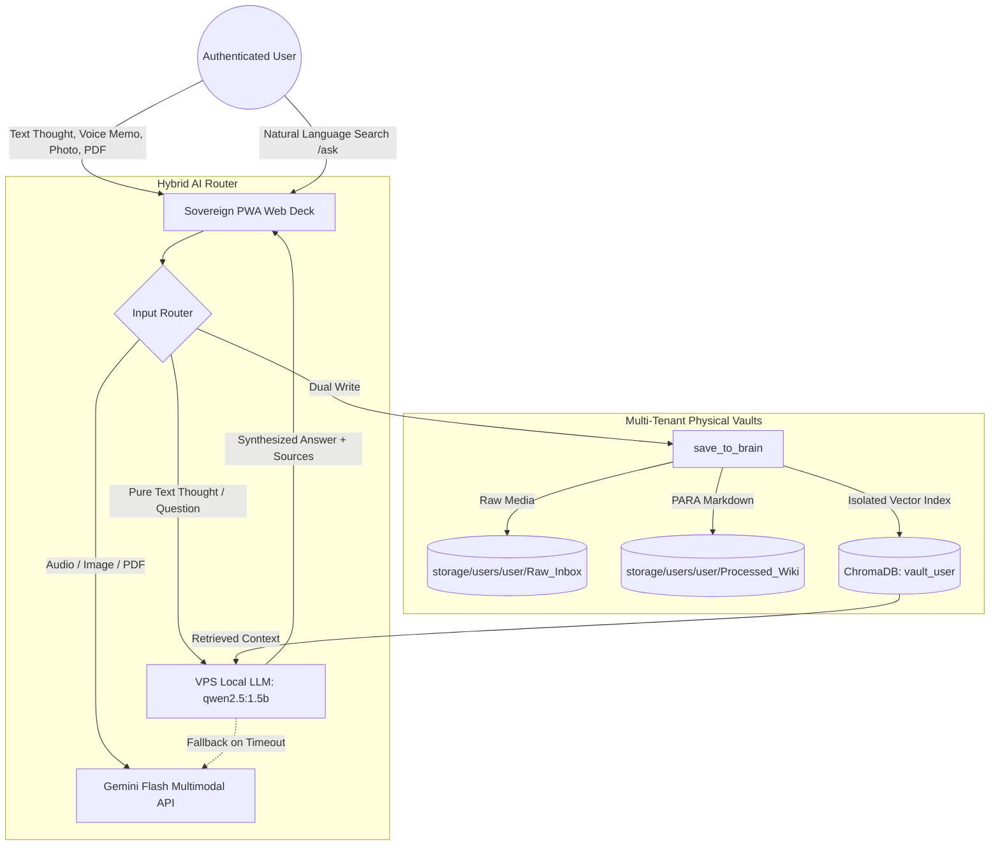

# Second Brain - Sovereign Multi-User Knowledge Engine

A self-hosted, multimodal personal knowledge and retrieval engine powered by a **Hybrid AI Router** (Local VPS LLM + Gemini Multimodal Cloud), strict multi-tenant vault isolation, and an installable Mobile PWA / Web deck.

---

## Architecture Overview



---

## Key Capabilities

### 1. Sovereign Web & Mobile PWA Interface
- **Zero Third-Party Intermediaries:** 100% self-hosted, independent frontend.
- **Native Browser Voice Memos:** Record audio thoughts directly from mobile or desktop browser microphone.
- **Drag & Drop Multimodal:** Snap phone photos, paste clipboard screenshots (`Ctrl+V`), or drop PDFs directly into the browser.
- **Conversational RAG (`/ask`):** Ask questions about past notes with instant source citations and temporal awareness (today's date calculations).
- **Mobile PWA Ready:** Installable on iOS (Safari Add to Home Screen) and Android (Chrome Install App) as a standalone app.

### 2. Hybrid AI Model Routing (Optimum Token & Speed Utilization)
- **Local VPS LLM (`qwen2.5:1.5b`):** Runs on your VPS via internal loopback (`127.0.0.1:11434`). Handles all pure text note classification, PARA slug generation, tagging, and queries in ~1 second with **0 cloud token cost**.
- **Gemini Multimodal Cloud:** Automatically invoked for heavy multimodal tasks: native voice transcription, document/PDF table extraction, and visual OCR.
- **Silent Fallback:** If the local model encounters high load or timeouts, it automatically falls back to Gemini Cloud so your note is never dropped.

### 3. Isolated Multi-User Vaults
- **Tenant Separation:** Each user has their own secure access token, separate physical disk directory (`storage/users/{username}/`), and separate ChromaDB collection.
- **Preconfigured Users:**
  - `shayeez` (10 GB storage quota)
  - `shamim` (10 GB storage quota)
  - `shayeez_shamim` (50 GB maximum storage quota)

---

## Quick Start (Local Development)

### 1. Setup Environment
```bash
python3 -m venv .venv
source .venv/bin/activate
pip install -e .
cp .env.example .env
```

### 2. Run Verification Tests
```bash
python test_multiuser.py
python test_auth.py
```

### 3. Launch Local Server
```bash
./run.sh
```
Open [http://localhost:8020](http://localhost:8020) and authenticate using your vault key.

---

## Production Deployment (VPS)

For full, step-by-step instructions on deploying to Ubuntu VPS, running alongside existing Nginx apps, configuring Systemd services, and pulling future updates via Git, see:

👉 **[DEPLOYMENT_GUIDE.md](file:///home/shayeez/projects/project-secondbrain/DEPLOYMENT_GUIDE.md)**
