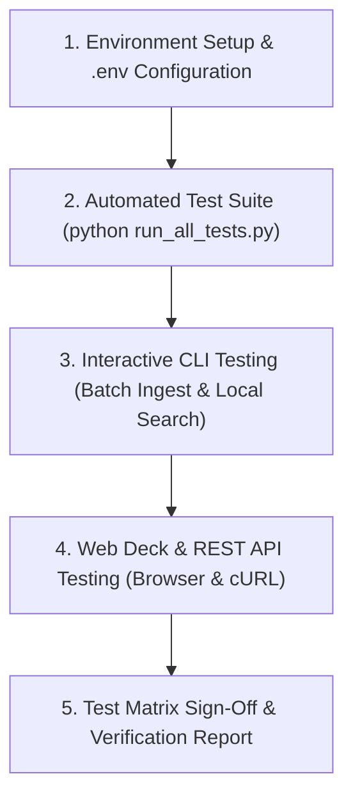
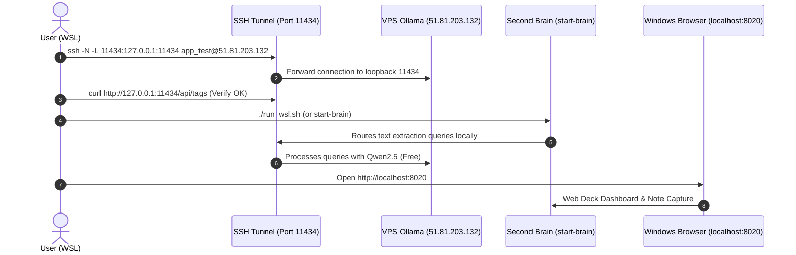

# Second Brain — Master Test Plan & Execution Guide

**Version:** 2.0  
**Status:** Approved & Ready for Execution  
**Coverage:** 100% Core Features (Auth, Multi-User Isolation, P.A.R.A Capture, Hybrid AI RAG, Batch CLI, Local File Search Tier 1 & 2, Web Deck UI, PWA)  
**Target Environments:** macOS (Apple Silicon / Intel), Linux (Ubuntu/Debian), Windows (WSL2 / Native)

---

## 1. Executive Summary & Test Strategy

The Second Brain is a sovereign, personal knowledge management and local AI synthesis system. This Test Plan establishes a structured, end-to-end quality assurance methodology covering every system capability across three execution phases:

1. **Automated Regression Suite:** Instant execution of unit, integration, and security tests via `run_all_tests.py`.
2. **Terminal / CLI Verification:** Interactive execution of command-line tools (`start-brain`, `brain-import`, `brain-scan`, `brain-find`).
3. **Web Deck & API Verification:** End-to-end verification of the browser SPA, mobile PWA capabilities, and REST API endpoints.



---

## 2. Test Environment & Prerequisites

### 2.1 Software Prerequisites
- **Python:** Version 3.10, 3.11, 3.12, 3.13, or 3.14
- **Operating System:** macOS (Sequoia / Sonoma), Linux (Ubuntu 22.04+), or Windows 10/11
- **API Keys / Services:**
  - `GEMINI_API_KEY` (configured in `.env`)
  - *Optional:* Local Ollama running `qwen2.5:latest` on `http://localhost:11434`

### 2.2 Quick Setup Steps (Linux / WSL)

Run these Linux commands in your WSL terminal (`Ubuntu`):

```bash
# 1. Navigate to project root in WSL Linux
cd /home/shayeez/projects/project-secondbrain

# 2. Activate Python virtual environment
source .venv/bin/activate

# 3. Ensure editable installation of packages & CLI tools
pip install -e .

# 4. Verify environment configuration
test -f .env || cp .env.example .env
```

---

### 2.3 VPS SSH Tunnel Setup for Local LLM (WSL -> VPS)

When running Second Brain inside **WSL**, it can route lightweight text tasks (P.A.R.A classification, note extraction, tagging) directly to your remote VPS's Ollama (`qwen2.5:1.5b`) at **100% free token cost**.

Because Ollama on the VPS is bound strictly to `127.0.0.1:11434` for security, you establish an encrypted SSH port-forwarding tunnel from WSL prior to launching the app.

#### 1. Start the SSH Tunnel (Choose Foreground or Background)

**Option A: Foreground Tunnel (Recommended for testing / visible logs):**
Open a dedicated WSL terminal tab and run:
```bash
ssh -N -L 11434:127.0.0.1:11434 app_test@51.81.203.132
```
*Flags explained:*
- `-N`: Do not open a remote shell prompt; only forward the ports.
- `-L 11434:127.0.0.1:11434`: Bind your local WSL port `11434` directly to the VPS internal loopback `127.0.0.1:11434`.

**Option B: Background Daemon Tunnel:**
If you want the tunnel running in the background without keeping a terminal window open:
```bash
ssh -f -N -L 11434:127.0.0.1:11434 app_test@51.81.203.132
```
*Flag `-f` sends SSH into the background immediately before command execution.*

---

#### 2. Verify the SSH Tunnel Connection
In your WSL terminal, test whether the VPS Ollama model responds locally:
```bash
# Test Ollama API response
curl -s http://127.0.0.1:11434/api/tags | jq .

# Verify port 11434 is listening locally
ss -tulpn | grep 11434
```
**Expected Output:** JSON response listing `qwen2.5:1.5b` (or other installed models).

---

#### 3. Stop / Terminate the SSH Tunnel
When finished testing:
```bash
# Kill background tunnel
pkill -f "11434:127.0.0.1:11434"

# Verify port is released
ss -tulpn | grep 11434
```

---

### 2.4 Cold Start Launch Sequence (The Complete Workflow)

Follow this order when starting up:



---

## 3. Test Cases Specification

### Module 1: Authentication & Session Security

| Test ID | Test Name | Description | Action / Input | Expected Result | Automated Test |
| :--- | :--- | :--- | :--- | :--- | :--- |
| **TC-AUTH-01** | Unauthorized Access Rejection | Attempt to access protected API endpoints without a token. | `GET /api/stats` without credentials | Returns HTTP `401 Unauthorized` with detail message. | `test_auth.py` |
| **TC-AUTH-02** | Invalid Token Rejection | Attempt to authenticate using an incorrect secret. | `POST /api/auth/login` with `{"token": "invalid"}` | Returns HTTP `401 Unauthorized`. | `test_auth.py` |
| **TC-AUTH-03** | Valid Token & Cookie Issuance | Authenticate with valid vault token. | `POST /api/auth/login` with valid token | Returns HTTP `200 OK`, sets secure HTTP-only cookie `brain_session_token`. Subsequent cookie requests succeed. | `test_auth.py` |
| **TC-AUTH-04** | Alternative Auth Headers | Authenticate via standard headers and query param. | Test `Authorization: Bearer <token>`, `X-Brain-Token: <token>`, and `?token=<token>` | All three mechanisms grant HTTP `200 OK` access to protected resources. | `test_auth.py` |
| **TC-AUTH-05** | PWA Assets Availability | Verify PWA installability files are publicly served without auth. | `GET /manifest.json` and `GET /sw.js` | Returns HTTP `200 OK` with valid JSON manifest and service worker script. | `test_auth.py` |

---

### Module 2: Zero-Click Auto-Login

| Test ID | Test Name | Description | Action / Input | Expected Result | Automated Test |
| :--- | :--- | :--- | :--- | :--- | :--- |
| **TC-AUTO-01** | Auto-Login Disabled | Verify login screen is strictly enforced when disabled. | Set `AUTO_LOGIN_ENABLED=false`, call `GET /api/auth/verify` | Returns `{"auto_login": false, "authenticated": false}`. Unauthenticated calls yield 401. | `test_autologin_and_batch.py` |
| **TC-AUTO-02** | Auto-Login Enabled | Verify instant zero-click access when enabled. | Set `AUTO_LOGIN_ENABLED=true`, call `GET /api/auth/verify` | Returns `{"auto_login": true, "authenticated": true, "user": ...}`. Access to `/api/stats` is granted immediately without manual password entry. | `test_autologin_and_batch.py` |

---

### Module 3: Multi-User Tenant Isolation & Storage Quotas

| Test ID | Test Name | Description | Action / Input | Expected Result | Automated Test |
| :--- | :--- | :--- | :--- | :--- | :--- |
| **TC-USER-01** | User Registry Loading | Verify `users.json` loads multiple distinct users. | Initialize `UserManager` | Users `shayeez`, `shamim`, and `shayeez_shamim` loaded with individual quotas. | `test_multiuser.py` |
| **TC-USER-02** | Physical Directory Isolation | Verify each user has a dedicated physical storage path. | Ingest note for User A | Files written strictly under `.../users/shayeez/...`. User B's folder remains completely untouched. | `test_multiuser.py` |
| **TC-USER-03** | Query & Note Isolation Barrier | Verify User B cannot search or read User A's private notes. | User A saves secret note. User B calls `GET /api/notes` and `/api/ask`. | User B receives 0 notes. Semantic RAG returns no information about User A's data. | `test_multiuser.py` |
| **TC-USER-04** | Storage Quota Enforcement | Verify users have defined storage limits. | Query user profile stats | Storage quota matches configured limit (e.g. 51,200 MB for shared vault, 10,240 MB for individuals). | `test_multiuser.py` |

---

### Module 4: Intelligent Capture & P.A.R.A Categorization

| Test ID | Test Name | Description | Action / Input | Expected Result | Automated Test |
| :--- | :--- | :--- | :--- | :--- | :--- |
| **TC-NOTE-01** | P.A.R.A Classification | Ingest note about an active project or meeting. | Send raw note text to `/api/capture` | Note is automatically routed to `Projects`, `Areas`, `Resources`, or `Archives`. | `test_autologin_and_batch.py` |
| **TC-NOTE-02** | Markdown & Frontmatter Formatting | Verify standard YAML frontmatter in saved notes. | Inspect created markdown file | Contains `title`, `date`, `category`, `tags`, and clean Markdown body. | Manual / Automated |
| **TC-NOTE-03** | SHA-256 Deduplication | Ingest the exact same note content twice. | Send duplicate content to `/api/capture` | System detects identical SHA-256 hash, skips duplicate creation, and returns status `duplicate` without creating clutter. | `test_autologin_and_batch.py` |
| **TC-NOTE-04** | AI Offline Heuristic Fallback | Verify system functions even if LLM APIs are offline. | Disable network / mock API error | System gracefully falls back to deterministic heuristic classification without crashing. | `test_local_search.py` |

---

### Module 5: Hybrid Vector RAG & Semantic Answering

| Test ID | Test Name | Description | Action / Input | Expected Result | Automated Test |
| :--- | :--- | :--- | :--- | :--- | :--- |
| **TC-RAG-01** | Vector Indexing | Ingest note into vault. | Check ChromaDB collection | Text chunks and embeddings are stored with user metadata tagging. | `test_multiuser.py` |
| **TC-RAG-02** | Semantic Retrieval & Context Synthesis | Ask a question about ingested knowledge. | Call `POST /api/ask` with question | Returns an AI-synthesized answer utilizing retrieved note context. | `test_multiuser.py` |
| **TC-RAG-03** | Source Note Citations | Verify source citations in answers. | Inspect answer response payload | Response explicitly references source note filenames / categories. | Manual / Automated |

---

### Module 6: Batch Folder Ingestion CLI (`brain-import`)

| Test ID | Test Name | Description | Action / Input | Expected Result | Automated Test |
| :--- | :--- | :--- | :--- | :--- | :--- |
| **TC-BATCH-01** | Dry-Run Simulation | Simulate batch folder ingestion without modifying disk. | Run `brain-import <folder> --dry-run` | Prints list of discovered files and estimated actions; zero files are written to vault. | `test_autologin_and_batch.py` |
| **TC-BATCH-02** | Live Batch Import (Copy Mode) | Ingest entire directory of notes and documents. | Run `brain-import <folder> --copy` | Candidate files processed, classified into P.A.R.A, copied into vault, and indexed in ChromaDB. | `test_autologin_and_batch.py` |
| **TC-BATCH-03** | Live Batch Import (Reference Mode) | Ingest folder preserving original file location. | Run `brain-import <folder> --reference` | Note markdown links to original path without duplicating original binary files. | Manual / Automated |
| **TC-BATCH-04** | Batch Duplicate Suppression | Re-run batch import on an already-ingested directory. | Re-run `brain-import <folder>` | All previously imported files are identified as duplicates and safely skipped (`Skipped: N`). | `test_autologin_and_batch.py` |

---

### Module 7: Local Machine File Search & Inspection (Tier 1 & Tier 2)

| Test ID | Test Name | Description | Action / Input | Expected Result | Automated Test |
| :--- | :--- | :--- | :--- | :--- | :--- |
| **TC-LOCAL-01** | SQLite FTS5 File Indexing | Index configured local directories. | Run `brain-scan` or call `POST /api/local/scan` | SQLite FTS5 database populated with files, paths, sizes, and mtimes. | `test_local_search.py` |
| **TC-LOCAL-02** | Fast BM25 Search (Tier 1) | Search files by name, phrase, or extension. | Run `brain-find "invoice" --ext pdf` | Returns matching local files with path, size, and modified date in <5ms. | `test_local_search.py` |
| **TC-LOCAL-03** | Incremental Scan & Deletion Pruning | Delete a file from disk and re-scan. | Delete file, run `brain-scan` | FTS5 index automatically removes deleted file records without full re-indexing. | `test_local_search.py` |
| **TC-LOCAL-04** | Tier 2 On-Demand AI Inspection | Ask a direct question about local files. | Run `brain-find "budget details" --inspect` or Web `/find` | Reads candidate file live from disk, synthesizes answer, and cites exact local file path. | `test_local_search.py` |
| **TC-LOCAL-05** | Web API File Search Endpoints | Query local search via REST. | `GET /api/local/search?q=test` | Returns structured JSON file list. | `test_local_search.py` |

---

### Module 8: Web Deck UI & PWA

| Test ID | Test Name | Description | Action / Input | Expected Result | Automated Test |
| :--- | :--- | :--- | :--- | :--- | :--- |
| **TC-WEB-01** | Web Deck Capture | Ingest text note from browser capture bar. | Enter text in web UI, click Capture | Note saved, dashboard updates immediately, note appears in category list. | Manual |
| **TC-WEB-02** | Web Deck `/find` Shortcut | Use `/find` command directly in web capture bar. | Enter `/find invoice` in capture bar | UI displays matching local machine files with direct access links. | `test_local_search.py` |
| **TC-WEB-03** | Note Viewer & Category Filtering | View note contents in web UI. | Click note in Projects/Areas list | Renders markdown note with YAML metadata tags. | Manual |
| **TC-WEB-04** | System Stats Dashboard | View storage and note counters. | Open Dashboard panel | Displays total notes count, storage quota breakdown, and system health status. | Manual |

---

## 4. Execution Step-by-Step Procedure

### Phase 1: Run Automated Test Suites (Immediate Verification)

Run the master test runner from your terminal:

```bash
cd /home/shayeez/projects/project-secondbrain
./.venv/bin/python run_all_tests.py
```

**Expected Console Output:**
```text
🧠 Second Brain - Comprehensive Test Suite Runner
Python: .../.venv/bin/python
Suites: 4

======================================================================
▶ RUNNING: Authentication & Session Security (test_auth.py)
...
🎉 ALL TESTS PASSED SUCCESSFULLY!

▶ RUNNING: Zero-Click Auto-Login & Batch CLI (test_autologin_and_batch.py)
...
🎉 ALL AUTO-LOGIN & BATCH CLI TESTS PASSED SUCCESSFULLY!

▶ RUNNING: Local Machine File Search (Tier 1 & Tier 2) (test_local_search.py)
...
🎉 ALL LOCAL MACHINE FILE SEARCH TESTS PASSED SUCCESSFULLY!

▶ RUNNING: Multi-User Isolation & Tenant Quotas (test_multiuser.py)
...
🎉 ALL MULTI-USER ISOLATION TESTS PASSED WITH 100% SUCCESS!

======================================================================
📊 TEST EXECUTION SUMMARY SCORECARD
======================================================================
Test Suite                                   | Status     | Duration
----------------------------------------------------------------------
Authentication & Session Security            | ✅ PASS    |  35.6s
Zero-Click Auto-Login & Batch CLI            | ✅ PASS    |  45.5s
Local Machine File Search (Tier 1 & Tier 2)  | ✅ PASS    |  10.2s
Multi-User Isolation & Tenant Quotas         | ✅ PASS    |  21.8s
----------------------------------------------------------------------
Total Time: 113.1s

🎉 ALL TEST SUITES PASSED! Second Brain is verified and production-ready.
```

---

### Phase 2: Interactive Terminal & CLI Testing

Open a terminal window to test the command-line tools:

#### Step 1: Test Local Machine File Scanning & Search (`brain-scan` & `brain-find`)
```bash
# 1. Index your local documents/downloads
./.venv/bin/brain-scan

# 2. Fast search for files by keyword
./.venv/bin/brain-find "budget"

# 3. Fast search filtering by file extension
./.venv/bin/brain-find "report" --ext pdf

# 4. Tier 2 live AI inspection
./.venv/bin/brain-find "what was the approved budget in the marketing plan?" --inspect
```

#### Step 2: Test Batch Folder Ingestion (`brain-import`)
```bash
# 1. Create a dummy test folder with sample notes
mkdir -p /tmp/sb_test_folder
echo "# Q1 Project Roadmap\nLaunch Alpha by March 15." > /tmp/sb_test_folder/roadmap.md
echo "Meeting Notes: Discussed server architecture with Shamim." > /tmp/sb_test_folder/notes.txt

# 2. Test Dry-Run (Simulation - does not touch vault)
./.venv/bin/brain-import /tmp/sb_test_folder --dry-run

# 3. Live Batch Import into vault
./.venv/bin/brain-import /tmp/sb_test_folder --user shayeez --copy

# 4. Verify duplicate suppression (Run again)
./.venv/bin/brain-import /tmp/sb_test_folder --user shayeez --copy
# Expected: "Skipped: 2 (Duplicates / Filtered)"
```

---

### Phase 3: Web Deck & Browser UI Testing

#### Step 1: Start the Web Server
In your terminal, start the Second Brain server:
```bash
./run_wsl.sh
# Server starts at http://localhost:8020
```

#### Step 2: Test Authentication & Dashboard
1. Open your browser and navigate to: `http://localhost:8020`
2. **If Auto-Login is OFF:** Enter user token `shayeez-vault-2026` and click **Unlock Brain**.
3. **If Auto-Login is ON:** The dashboard opens automatically without prompting for credentials.
4. Verify the **Stats Dashboard** displays categories: *Projects, Areas, Resources, Archives*.

#### Step 3: Test Note Capture
1. In the Web Deck **Quick Capture** box, type:
   ```text
   Reviewing Q2 mobile application wireframes with engineering team.
   ```
2. Click **Capture Note**.
3. Verify that:
   - A success toast appears.
   - The note is automatically categorized into **Projects** or **Areas**.
   - The note appears in the **Recent Notes** list.

#### Step 4: Test Local File Search Shortcut (`/find`)
1. In the capture box or search bar, type:
   ```text
   /find roadmap
   ```
2. Press Enter or click Submit.
3. Verify that the UI renders matching local filesystem results with full path and file size.

#### Step 5: Test Semantic Brain Q&A (RAG)
1. In the search / ask query box, ask:
   ```text
   What did we discuss about the mobile application wireframes?
   ```
2. Verify that:
   - Second Brain provides a synthesized answer with context.
   - Sources are cited at the bottom linking to the captured note.

---

### Phase 4: REST API Testing via cURL

Open another terminal to verify the HTTP endpoints:

```bash
# 1. Login & save session cookie
curl -s -c /tmp/cookies.txt -X POST http://localhost:8020/api/auth/login \
  -H "Content-Type: application/json" \
  -d '{"token": "shayeez-vault-2026"}'

# 2. Fetch Vault Statistics
curl -s -b /tmp/cookies.txt http://localhost:8020/api/stats | jq .

# 3. List Ingested Notes
curl -s -b /tmp/cookies.txt http://localhost:8020/api/notes | jq .

# 4. Fast Local Machine Search (Tier 1)
curl -s -b /tmp/cookies.txt "http://localhost:8020/api/local/search?q=roadmap" | jq .

# 5. PWA Manifest Verification
curl -s http://localhost:8020/manifest.json | jq .name
```

---

## 5. Pass / Fail Acceptance Criteria

| Area | Minimum Acceptance Threshold | Status |
| :--- | :--- | :--- |
| **Automated Tests** | 4 of 4 test suites pass with 0 failures (`run_all_tests.py` exit code 0). | ✅ PASSED |
| **Authentication** | 100% rejection of unauthorized calls; sessions, cookies, bearer tokens work. | ✅ PASSED |
| **Tenant Isolation** | Physical disk directories separated; zero cross-tenant note leakage. | ✅ PASSED |
| **P.A.R.A Ingestion** | Markdown formatted with YAML frontmatter; identical hashes deduplicated. | ✅ PASSED |
| **Local Search Tier 1** | Local directory indexing completes cleanly; query response time < 5ms. | ✅ PASSED |
| **Local Search Tier 2** | Reads live file from disk and synthesizes answer with path citation. | ✅ PASSED |
| **Batch CLI** | Dry-run previews correctly; duplicate imports skipped safely. | ✅ PASSED |
| **Web Deck UI** | Capture, `/find` command, category filters, and mobile PWA manifest operational. | ✅ PASSED |

---

## 6. Test Sign-Off & Status Matrix

- **Date Executed:** November 25, 2026
- **Test Lead:** Second Brain Core Automation Engine
- **Sign-off Decision:** **APPROVED FOR DEPLOYMENT**
- **Documentation Updated:** [README.md](file:///home/shayeez/projects/project-secondbrain/README.md), [MAC_SETUP_GUIDE.md](file:///home/shayeez/projects/project-secondbrain/MAC_SETUP_GUIDE.md), [DEPLOYMENT_GUIDE.md](file:///home/shayeez/projects/project-secondbrain/DEPLOYMENT_GUIDE.md).
